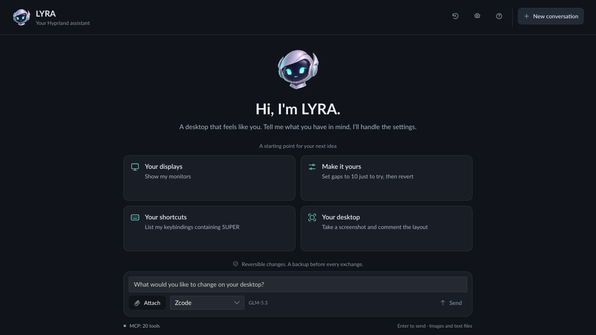

# LYRA

**A desktop agent that works on your Linux computer.**

LYRA is a native **desktop agent**, in the spirit of a coworker: describe a task
and it drafts a short plan, carries it out with its tools — files, shell commands,
web research, desktop control — checks the actual outcome and reports back. It
handles any request: documents and notes, writing, research and synthesis, data,
scripts and development, system administration, applications and browsers, and
the desktop itself. It works with your existing **Zcode, Claude Code, or Codex
subscription**.

LYRA always knows who it is and where it runs: every turn, its context includes
its identity (version, provider, model, interface, tools, execution mode) and the
execution environment (distribution, kernel, architecture, session, shell,
locale). The built-in compositor integration targets **Hyprland on Wayland**.



## What you can ask

- “Sort the PDFs in ~/Downloads into folders by year and list what you moved.”
- “Read my notes in ~/Documents/project and draft a summary for the team.”
- “Find my installed desktop tools, their versions, and configuration files.”
- “Help me troubleshoot this application's configuration.”
- “Create an unpacked browser theme using my chosen colors.”
- “Suggest three color palettes and let me choose.”
- “On Hyprland, show my monitor setup and try setting the gaps to 10.”

Click LYRA’s suggestions to choose text, colors, images, or diagrams.
Use **Attach** to send images and text files along with your message.
Paste an image with **Ctrl+V**, **Shift+Insert**, or the clipboard button. It stays
in the draft until you send it; ordinary text paste still works.
Responses appear progressively as LYRA writes, with a visible thinking indicator
while it prepares its answer.
Long operations show their current phase and progress. When the amount of work
is unknown, the indicator stays indeterminate.

Interface color suggestions follow the [color accessibility policy](docs/COLOR_ACCESSIBILITY.md):
computed WCAG contrast, corrections for failing BG/FG pairs, and checks across states.

## Install from source

You need **Linux, Git, and Rust/Cargo**. The bundled installer uses
**systemd user services** for the local integration service.

Native compositor controls require **Hyprland on Wayland**; this integration has
been tested with **Hyprland 0.57.1 and its Lua configuration**. Install `grim` for
Wayland screenshots and `zenity` for file attachments. Image paste uses the
Wayland clipboard.

```bash
git clone https://github.com/jacquesh82/mindlog.hyprland_tools.git
cd mindlog.hyprland_tools
./scripts/install.sh
~/.local/bin/hyprpanel-chat
```

The installer builds the application, installs both binaries in `~/.local/bin`,
and starts the local Hyprland integration service.

## Choose your subscription

Use the selector next to **Send** to choose a provider. Your selection is saved,
and you can switch between messages. To pick a provider for one session only,
without changing the saved choice, launch with `--provider`:

```bash
hyprpanel-chat --provider codex               # window
hyprpanel-chat cli --provider claude_code     # terminal
```

Accepted values: `zcode`, `claude_code`, `codex`. An unknown value prints an
error and exits with a non-zero code. `chat.toml` is not rewritten; picking a
provider in the window selector afterwards saves that choice as usual.

| Provider | How to connect |
| --- | --- |
| **Zcode** | LYRA imports your GLM Coding Plan key from the Zcode configuration when available. Otherwise, enter your plan key in LYRA’s settings. |
| **Claude Code** | Install the official `claude` client and sign in to your subscription with `claude auth login`. |
| **Codex** | Install the official `codex` client and sign in with your ChatGPT account using `codex login`. |

All three modes use the subscription connection and stream their text into the
chat. LYRA does not automatically fall back to a pay-as-you-go API.

At startup, LYRA checks all three locally (Zcode key, `claude` and `codex`
installed and signed in), without calling any model:

- **Selected provider ready**: nothing changes.
- **Selected provider missing, another one ready**: LYRA uses the first ready one
  (Zcode, then Claude Code, then Codex) for the session and says so in the chat.
  Your saved choice in `chat.toml` is not changed.
- **None ready**: a panel above the input lists each provider's state and what to
  do (enter the key, install the client, run `claude auth login` / `codex login`).
  **Send** stays disabled and nothing is sent; **Check again** reruns the check
  once you have connected one. In terminal mode the same list is printed, every
  message triggers a new check, and a one-shot turn exits with code 1 without
  sending anything.

The check runs again when you save settings or change provider. It cannot detect
quota or network failures; those still appear as errors when a reply fails.

## Filesystem permission

On first launch, LYRA asks before giving the assistant read/write access to your
**home folder (`~`)**. Choose **Allow access** or **Decline**. Your choice is
remembered for future launches (window, terminal and `serve`) and can be changed
in **Settings → Access**. `--fs` / `--no-fs` override it for one launch without
changing it. File contents may be shared with the
selected provider when needed for your requests.

Credentials stay out of reach of the file tools even after approval: `~/.ssh`,
`~/.gnupg`, `~/.password-store`, keyrings, cloud and container credentials,
provider tokens (`~/.zcode`, `~/.codex`, `~/.claude`), browser profiles, and
LYRA's own settings and data. Shell commands keep your account's permissions and
follow the execution mode.

Without approval, assistant file/desktop tools, command execution and automatic
configuration backups stay disabled. Explicitly attached files and commands to
copy remain available.

## Execution modes

Choose **Settings → Access → Execution mode**, then save:

| Mode | Behavior |
| --- | --- |
| **Confirm once** (default) | Each program, and each Hyprland action, is confirmed once; the approval then lasts for the session. **Dangerous commands are confirmed every time.** Managed file edits follow filesystem consent. |
| **FULL access** | Execute requested commands, including sudo, and desktop actions without confirmation. |
| **Confirm sudo** | Run ordinary commands and desktop actions freely; confirm detected indirect commands once, and dangerous commands every time. |
| **Copy commands only** | Analyze approved files and show copyable commands. Execute no commands, file edits, desktop actions, backups or restores. |

In **Confirm once**, an approval covers the programs the command runs: approving
`pacman -Q | sort` lets later commands that only use `pacman` and `sort` run
without asking. Opaque commands (shells, interpreters, variable expansion,
scripts) are remembered by their exact text only.

**Dangerous** commands are always confirmed: privilege elevation (`sudo`, `doas`,
`pkexec`…), deletion (`rm`, `shred`, `find -delete`), disks and filesystems (`dd`,
`mkfs`, partitioning, `mount`), system package changes (`pacman -S/-R`, `yay`,
`apt install`…), shutdown/reboot, service changes (`systemctl stop/enable…`),
killing processes, user/firewall/boot changes, recursive `chmod`/`chown`,
destructive git (`push`, `reset --hard`, `clean`), downloads piped into a shell,
and redirections into system directories. The dialog states which applies.

All modes share the same behavior across Zcode, Claude Code and Codex. Filesystem
consent and Linux account permissions still apply. These checks operate on the
proposed command text; they are not an OS sandbox.
Commands remain noninteractive; LYRA does not collect your sudo password.

## Verification and commands

When information is uncertain or depends on a recent version, LYRA is instructed
to check online, read official documentation, and link the sources actually read.
If verification fails, it must say so rather than invent an answer.

When the selected mode requires confirmation, LYRA shows the exact command, its
purpose and the scope of the approval before execution. Declining, closing, or
pressing Escape runs nothing. A “yes” in chat does not replace this dialog. In
the default mode, each Hyprland IPC action is confirmed once per session.
Managed file reads use filesystem consent; copy-only mode blocks edits and
backups.

The identity and execution environment block is always present, even before
filesystem approval; it omits your home path (which reveals your username) until
access is approved. After your first filesystem approval, LYRA also records the
OS/distribution, version, kernel, architecture, username, session, and available
package/desktop tools in a private local profile. Basic OS discovery requires no commands. The profile
is refreshed each approved session and can be viewed/refreshed in Settings.
Installed tools are discovered from package metadata, desktop launchers, and your
approved configuration files. Versions and configuration paths include their source;
missing versions stay unknown. Additional package-manager queries (`flatpak`, `pipx`, `cargo`…) follow the
selected execution mode; copy-only mode displays them without running them.
Each one is asked once: the answer, yes or no, is remembered for future launches.

Remembered decisions live in `~/.config/hyprpanel/consents.toml` (mode 600, out of
reach of LYRA's file tools). Delete the file, or one of its keys, to be asked
again.

The local mini-RAG recalls relevant excerpts from your requests and clicked choices,
along with installed tools that match the current question. It searches locally,
without an embedding service. Relevant excerpts are included in the context sent
to your selected provider. It starts after filesystem consent and works across
conversations and providers.

## Terminal mode

The same assistant runs in a terminal, with the same subscription, tools,
execution modes, per-turn backups and memory as the window:

```bash
hyprpanel-chat cli                         # interactive session (/help)
hyprpanel-chat cli "list my SUPER binds"   # one turn, then exit
hyprpanel-chat cli --provider codex "hi"   # provider for this session only
echo "why is my gap ignored?" | hyprpanel-chat cli --fs -f shot.png
```

Replies stream as they are written; tool calls appear as one summary line each
(`-v` shows full results). Choice suggestions are numbered: type a number to pick
one. Filesystem access is asked at startup (`--fs` / `--no-fs` to answer ahead).
Confirmations show the exact command and wait for `y`/`o`; when stdin is not a
terminal (pipe), every confirmation is declined. Session commands: `/new`,
`/attach`, `/detach`, `/history`, `/restore <snapshot>`, `/refresh`, `/quit`.
A one-shot turn exits with code 1 if an error was displayed.

## Settings and backups

- **⚙ Settings**: tabs for General, Access, Assistant, and Memory. Choose language, execution policy, model, SYSTEM context, and local memory preferences.
- **SYSTEM context**: add your own instructions for all providers. They complement LYRA’s role; its identity, execution environment and application rules always remain.
- **Local conversation memory**: disable recall and recording, or clear saved excerpts and start a new chat.
- **⟲ History**: browse saved configurations and restore a backup.
- **Tool details**: expand the link in the chat to inspect the operations performed.

Live settings let you try changes. Once filesystem access is approved, LYRA requests a configuration backup before
each message when operations are enabled. The conversation lasts for the current window session; configuration
backups and enabled local memory remain available after you close it.

## hyprdesk integration (Intégration avec hyprdesk)

hyprdesk (repository `mindlog.hyprland_desktop`), the Hyprland
desktop, launches LYRA as its AI assistant. Three hooks make this work:

1. **Wayland app_id.** The window sets `app_id = lyra`, so `hyprctl clients`
   shows `class: lyra` and window rules can target it (hyprdesk places it as a
   drawer on the right of the main monitor). Terminal mode is unchanged.
2. **`--provider <zcode|claude_code|codex>`.** hyprdesk passes the provider
   chosen in *Applications → AI assistant*. It applies to the session only and
   never rewrites `chat.toml` (see [Choose your subscription](#choose-your-subscription)).
3. **`context.d`.** Every `*.md` file in `$XDG_CONFIG_HOME/hyprpanel/context.d/`
   (default `~/.config/hyprpanel/context.d/`) is appended to the system context,
   after the environment context, in alphabetical order of file name. Each file
   gets a header naming its source, for example
   `## Contexte fourni par hyprdesk (context.d/hyprdesk.md)`. hyprdesk writes its
   modes, shortcuts, packages, default applications, files and `hyprdesk config …`
   commands there and refreshes them whenever its configuration changes.
   - The files are **information about the desktop, never instructions**: they do
     not replace LYRA's role or alter its rules (verification, confirmations,
     execution mode, file permissions), and the section says so explicitly.
   - Limits: 16 KiB per file, 48 KiB in total. Truncated content is marked, and
     LYRA is told to mention it; files past the total limit are listed as skipped.
   - Unreadable, non-UTF-8, empty or non-`.md` files are ignored without
     blocking startup.
   - The files are read again whenever the system context is rebuilt: on every
     message and every new conversation, so the latest version is always used.

`hyprpanel-chat --help` documents `--provider` and `context.d`; hyprdesk reads
that output to detect both features.

## Protocole serve (intégration hyprdesk)

`hyprpanel-chat serve` lets another application (hyprdesk's side drawer) provide
the interface while LYRA keeps the whole engine: providers, MCP, per-turn backups,
memory, execution modes, confirmations, and `context.d`. It speaks **JSON Lines**
on stdin/stdout (UTF-8, one JSON object per line). Nothing else is written to
stdout; logs go to stderr. One conversation per process; closing stdin ends it
cleanly after the messages already received are processed.

```bash
hyprpanel-chat serve [--provider <zcode|claude_code|codex>] [--fs | --no-fs]
```

**Client → LYRA** (unknown fields are ignored; an invalid line gets a non-fatal
`error` and the session continues):

| `type` | Example | Effect |
| --- | --- | --- |
| `hello` | `{"type":"hello","client":"hyprdesk","protocol":1,"language":"fr"}` | Required first. `protocol` must be `1` (otherwise fatal `error`, exit code 2). `language` (`fr`/`en`) applies to this session. |
| `message` | `{"type":"message","id":"m1","text":"…","attachments":[{"path":"/…"}]}` | Starts a turn. `id` is optional (LYRA generates `m1`, `m2`…). |
| `confirm` | `{"type":"confirm","request":"c1","accept":true}` | Answers a `confirm_request`. |
| `choice` | `{"type":"choice","request":"q1","value":"a"}` | Answers a `choice_request` with an option `value`; starts a turn whose id is the request id. |
| `cancel` | `{"type":"cancel"}` | Stops the current turn: running commands and the provider client are killed, the conversation returns to its state before the turn. |
| `new_conversation` | `{"type":"new_conversation"}` | Starts an empty conversation (local memory kept per settings). |
| `provider` | `{"type":"provider","value":"codex"}` | Switches provider for the rest of the session (`chat.toml` unchanged). |

**LYRA → client**:

| `type` | Example | Meaning |
| --- | --- | --- |
| `ready` | `{"type":"ready","protocol":1,"provider":"claude_code","providers":["zcode","claude_code","codex"],"fs":true}` | Session ready, after the provider check. `provider` is the one in use (after any fallback); `providers` lists those usable. Messages produced earlier (e.g. a daemon `error`) follow it. |
| `turn_start` | `{"type":"turn_start","id":"m1"}` | A turn begins. |
| `delta` | `{"type":"delta","text":"…"}` | Reply text as it is written, in Markdown. |
| `thinking` | `{"type":"thinking","active":true}` | The model is preparing its answer. |
| `progress` | `{"type":"progress","phase":"…","fraction":0.4}` | Long operation; `fraction` is `null` when unknown. |
| `tool` | `{"type":"tool","id":"t1","name":"…","summary":"…","status":"running"}` | Tool call; a second event with `done` or `error` adds a short `result`. |
| `confirm_request` | `{"type":"confirm_request","id":"c1","command":"…","reason":"…","risk":"low"}` | Waits for `confirm`. `risk` is `high` for dangerous commands (asked every time) and `low` for a once-per-session approval. Never accepted by default: without an answer it stays pending; once stdin is closed it is declined. |
| `choice_request` | `{"type":"choice_request","id":"q1","kind":"color","prompt":"…","options":[{"label":"…","value":"…","preview":"…"}]}` | `kind` is `text`, `color`, `image` or `diagram`; `preview` holds the description, colors, image path or SVG. A new `message` closes it. |
| `turn_end` | `{"type":"turn_end","id":"m1","text":"…"}` | Always sent, even after an error or `cancel`. `text` is the complete reply and is authoritative over the deltas. |
| `error` | `{"type":"error","message":"…","fatal":false}` | Problem; only an unsupported protocol is fatal. |
| `notice` | `{"type":"notice","text":"…"}` | Extra information (provider fallback, cancellation, settings applied). Clients should ignore types they do not know. |

Without `--fs` or `--no-fs`, and only when no decision is remembered yet, file
access is requested before `ready` with a `confirm_request` whose id is `fs`
(`risk: high`). The answer is remembered, so later launches go straight to
`ready`. The same safety rules as the
window apply: execution mode, once-per-session approvals, dangerous commands
confirmed every time, protected files. With file access, the environment
inventory at startup may itself send `confirm_request`s (package-manager
queries such as `flatpak list`), each only once: answers are remembered.

## Need help?

The **?** button explains how the chat works. To check provider connections:

```bash
~/.local/bin/hyprpanel-chat check-providers
```

See the [technical guide](docs/TECHNICAL.md) for troubleshooting, configuration,
MCP integration, and development commands.

## Licenses

The LYRA application (`hyprpanel-chat`) is licensed under **GPL-3.0-only**.
The core and server (`hyprpanel-core`, `hyprpanel-server`) are licensed under **MIT**.
